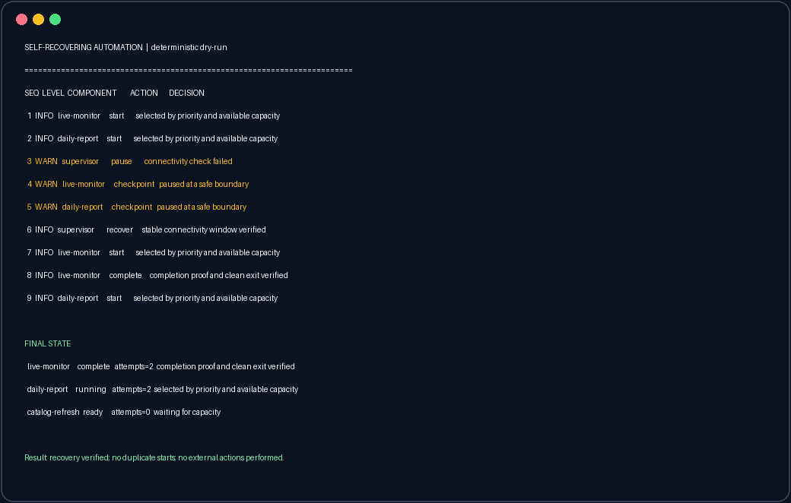

# Self-Recovering Automation

> A public-safe demonstration of an automation manager that schedules work,
> detects failure, pauses safely, and recovers without creating duplicate jobs.


Modern automation rarely fails in a clean, predictable way. A network can
drop halfway through a job, a process can disappear, a machine can become too
busy, or an application can exit before saving its work. This project shows
how a control plane can make those situations boring: observe the system,
classify the problem, preserve state, and resume only when it is safe.

This repository is a standalone reference implementation inspired by a larger
private system. It contains no production integrations, credentials, private
configuration, or machine-specific paths.

## Dry-run dashboard

The screenshot below is generated from the same deterministic dry-run used by
the tests. Its output passes through an automatic privacy filter before the
asset is written.



## What it demonstrates

- **Priority-aware scheduling** — important continuous work is considered
  before lower-priority batch jobs.
- **Capacity-aware starts** — jobs are admitted by weight so recovery cannot
  trigger a start storm.
- **Failure isolation** — one failing job changes only its own state unless a
  genuinely global condition affects the whole system.
- **Safe pause and recovery** — connectivity loss checkpoints active work and
  requires an explicit stable recovery signal before resuming.
- **Clear failure classes** — temporary problems enter cooldown; durable
  problems request attention instead of retrying forever.
- **Completion proof** — a process ending is not automatically treated as a
  successful run.
- **Structured decisions** — every transition records the component, action,
  and reason in a human-readable event stream.

## Why this matters

For a non-technical operator, the system answers three practical questions:

1. What is running?
2. Why did the manager make that decision?
3. What must become true before work can continue?

For an engineer, the core value is the separation between observation,
policy, and action. That boundary makes recovery behavior deterministic,
testable, and much less likely to fight the user or duplicate work.

## Quick start

No service, browser, account, or external dependency is required.

```bash
git clone <repository-url>
cd Self-Recovering-Automation
python demo.py --dry-run
python -m unittest discover -s tests -v
```

Optional editable installation:

```bash
python -m pip install -e .
automation-demo --dry-run
```

## State model

```text
READY -> RUNNING -> COMPLETE
  |         |
  |         +-> PAUSED -> READY
  |         +-> COOLDOWN -> READY
  |         +-> ATTENTION
  +--------------------------^
```

`ATTENTION` is intentionally not self-clearing. The demonstration requires an
explicitly resolved condition instead of guessing that a durable problem went
away.

## Repository layout

```text
.
├── assets/                 # Sanitized dry-run screenshot
├── docs/architecture.md    # Design boundaries and data flow
├── scripts/                # Reproducible asset generation
├── src/self_recovering_automation/
│   ├── engine.py           # Scheduling and recovery state machine
│   ├── model.py            # Typed job and event models
│   └── cli.py              # Deterministic terminal demonstration
├── tests/                  # Failure, capacity, and recovery tests
├── demo.py                 # Zero-setup entry point
└── pyproject.toml
```

## Safety and privacy

This public project is simulation-only. It does not start or stop operating
system processes and cannot access external services. The asset generator
masks email addresses, user-directory paths, token-like values, and long
identifiers before producing a screenshot. The committed example uses only
synthetic component names and events.

## What is intentionally excluded

The private production system includes real process hosting, persistent
recovery state, interactive terminal management, and application adapters.
Those implementation details are not needed to evaluate the engineering
approach and are deliberately absent here.

See [the architecture notes](docs/architecture.md) for the public design.
