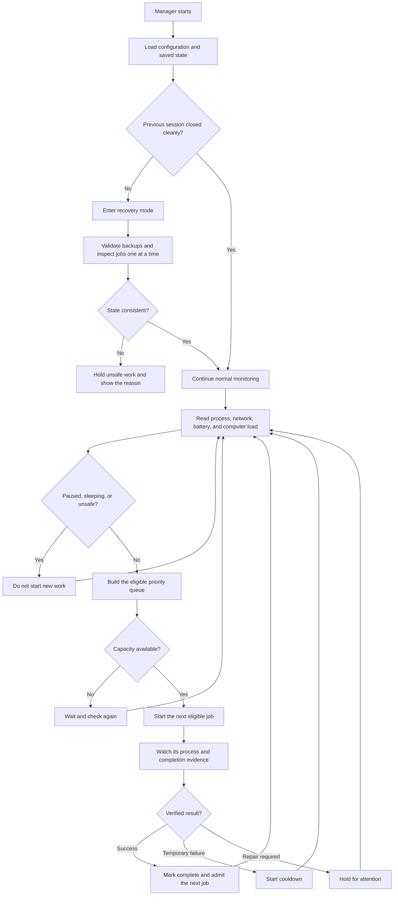
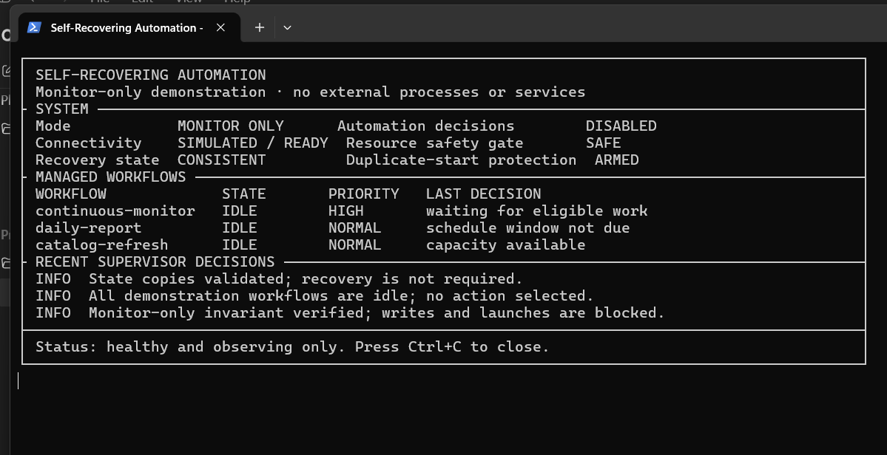
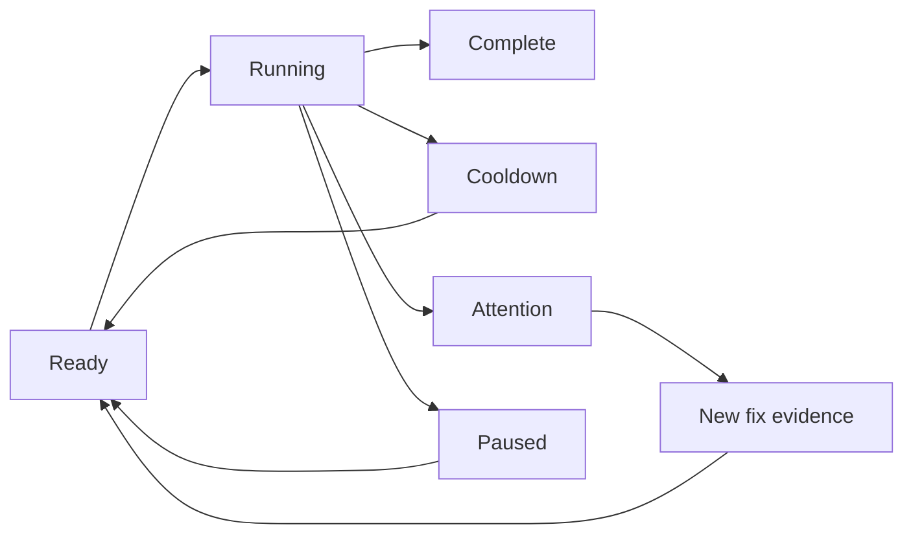

# Self-Recovering Automation

This repo shows a manager I built to keep several automation projects running
safely from one place.

It decides what can start, prevents duplicate programs, watches the computer
and network, separates one bot failure from the rest of the system, and waits
for real completion proof before calling a run successful. If the manager is
interrupted, it checks saved state before normal work continues.

The public version uses fake jobs. It does not start real programs or contain
private paths, accounts, credentials, or bot settings.

## What it does

- Starts important live jobs before lower-priority daily work.
- Starts only the amount of work the computer can handle.
- Prevents two copies of the same job from running.
- Pauses new decisions without touching jobs that are already running.
- Supports sleep mode, which safely stops work and blocks restarts for a set
  time.
- Gives temporary failures a cooldown.
- Keeps repair-required failures stopped until there is evidence of a fix.
- Requires a fresh completion result instead of trusting a closed window or
  old log line.
- Recovers carefully after an unexpected manager shutdown.

## Manager flow



The main rule is simple: starting a program is not the same as completing its
work. The manager checks the result separately.

## Monitor-only screen

This is the included terminal monitor running with fake idle jobs. Monitor-only
mode can display status but cannot launch or change a job.



Open the same screen locally:

```bash
python monitor.py
```

Render one frame without keeping the monitor open:

```bash
python monitor.py --once
```

## How failures are handled

| Situation | Manager response |
| --- | --- |
| One job crashes | Isolate that job and leave unrelated work alone |
| Several jobs become due together | Use priority and available capacity instead of starting all of them |
| Network connection drops | Block new work and wait for a stable recovery period |
| A process exits without a valid result | Mark the run incomplete and follow its retry rule |
| A job reports a temporary problem | Start a cooldown and make it eligible later |
| A job reports a repair-required problem | Keep it stopped until newer evidence shows a real fix |
| An old process ID or log remains | Check current process identity and fresh timestamps before deciding |
| The manager closes unexpectedly | Keep an unclean marker and validate state on the next start |
| Monitor-only mode is active | Observe only; never launch, stop, or write control markers |

## Job states



- `Ready` means the job is eligible but has not started.
- `Running` means the manager can identify the active job.
- `Complete` requires a fresh result that proves useful work finished.
- `Cooldown` is a temporary delay before another attempt.
- `Attention` means the same run should not be repeated without a fix.
- `Paused` keeps the current state while automatic decisions are off.

## Priority and computer load

Each job has a priority and an estimated resource weight. The manager checks
available capacity before each start. This stops a restart or morning backlog
from opening every browser and script at the same time.

The queue is recalculated whenever a job starts, finishes, becomes blocked, or
the computer's condition changes. A lower-priority job is not forgotten. It
stays in the queue until it is complete, blocked for a clear reason, or no
longer due.

## Recovery demo

`demo.py` walks through a fixed failure and recovery sequence:

1. select work by priority and capacity;
2. simulate a lost connection;
3. preserve running job state;
4. wait for recovery proof;
5. resume eligible work;
6. accept completion only after a fresh result.

```bash
python demo.py --dry-run
```

The demo does not start an operating-system process or contact an external
service.

## Run the tests

```bash
python -m unittest discover -s tests -v
```

The tests cover capacity limits, duplicate prevention, disconnect recovery,
cooldowns, attention states, completion proof, and monitor-only safety. GitHub
Actions runs the same checks on every push and pull request.

## Repository layout

```text
.
├── assets/monitor-only.png
├── docs/architecture.md
├── scripts/capture_monitor.ps1
├── src/self_recovering_automation/
│   ├── engine.py       # Priority, capacity, failure, and recovery decisions
│   ├── model.py        # Job states and decision events
│   ├── monitor.py      # Stable monitor-only screen
│   └── cli.py          # Fixed recovery demo
├── tests/
├── demo.py
├── monitor.py
└── pyproject.toml
```

## Public version

This repo contains no real bot launchers, credentials, user IDs, computer
paths, private rules, or marketplace connections. The full system adds real
process hosting, interactive terminal screens, saved state, and per-project
safety checks behind the same basic flow.

See [the architecture notes](docs/architecture.md) for the module map.
