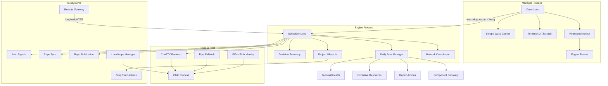
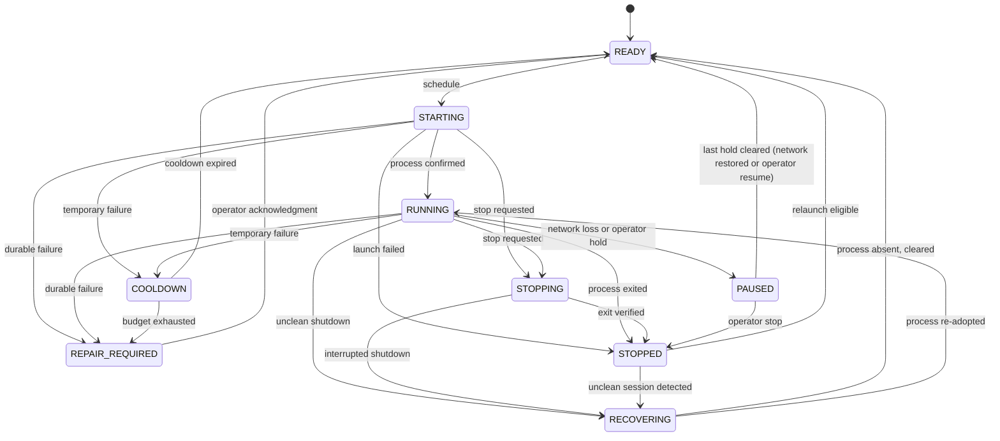
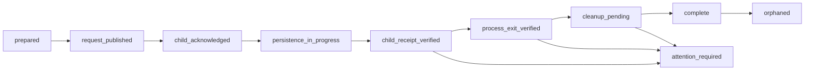
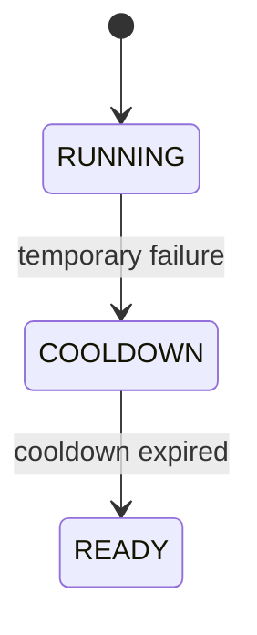
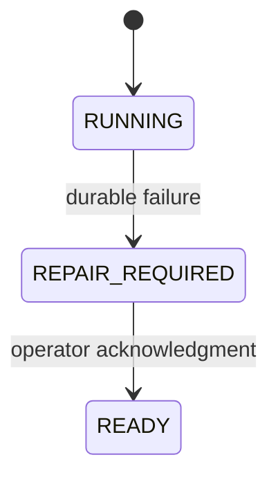
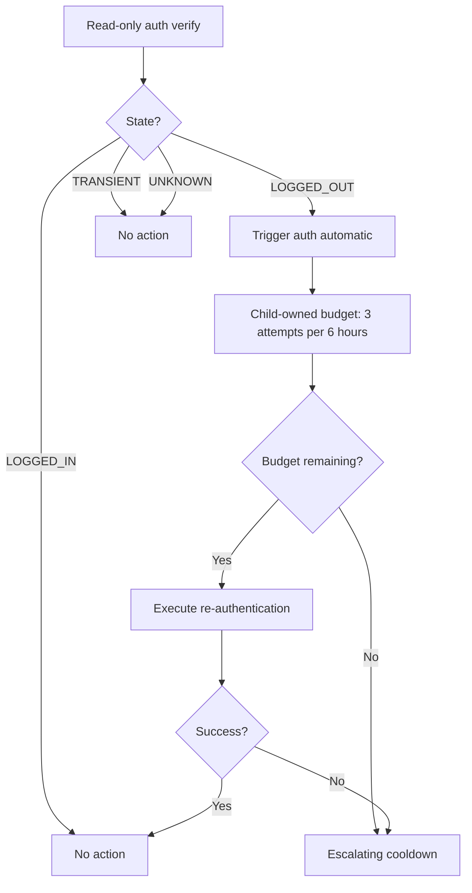

# Supervisor Public

A sanitized architectural model of a self-recovering automation supervisor.

This repository publicly represents the architecture, state flow, recovery philosophy, and engineering decisions behind a private production supervisor that coordinates 25+ long-running automation projects. It is not the production system itself.

## What the Supervisor does

The Supervisor is not one automation script. It is a two-process orchestration system that manages the full lifecycle of automation projects: scheduling, process ownership, failure detection, recovery, coordinated shutdowns, and repository publication.

The production implementation runs on Windows and coordinates live marketplace bots, daily verification jobs, and local applications. It enforces single-instance locking, adaptive polling, network-aware scheduling, PID-reuse-safe process identity, multi-phase stop transactions, and machine-readable decision auditing. This public model communicates the same architectural concepts through a lightweight, deterministic state machine.

## Architecture



The Supervisor uses a two-process architecture. The manager process runs an outer loop that monitors the engine's heartbeat. If the engine hangs (no heartbeat advance within the timeout), the manager restarts it. The engine process runs the inner scheduling loop and makes all decisions.

## Lifecycle

Projects move through explicit states with validated transitions:



| State | Meaning |
|-------|---------|
| READY | Eligible for scheduling. Not running, not in cooldown, not held. |
| STARTING | Launch initiated. Process identity being confirmed within the starting window. |
| RUNNING | Process confirmed alive with verified PID + birth marker identity. |
| STOPPING | Graceful stop requested. Awaiting child acknowledgment and exit verification. |
| STOPPED | Process confirmed exited. Completion proof verified. Ready for relaunch. |
| COOLDOWN | Temporary failure. Waiting for cooldown timer before retry. Structured reason recorded. |
| REPAIR_REQUIRED | Durable failure. Requires operator action or verified fix evidence. Not auto-retried. |
| PAUSED | Held by operator or network loss. Resumes when the hold is released. |
| RECOVERING | Prior session unclean. Ownership unverified. Held until inspection completes. |
| RESTART_HOLD | Operator-initiated hold with optional indefinite mode. Prevents scheduling until released. |

Key design principle: **a failed state never auto-resolves downward in severity.** Repair-required projects remain visible until real fix evidence or an explicit operator acknowledgment returns them to the eligible queue.

## Process ownership

The Supervisor must know which process belongs to which managed project. A PID alone is not enough.

The production implementation verifies process identity through PID plus Windows process creation timestamp (birth marker). A live process with a different birth time proves the original exited and the operating system reused its PID. The Supervisor never trusts a PID file or Task Scheduler state without independent verification.

Before adopting a process, the Supervisor also verifies argv and cwd match the expected launch parameters. This prevents duplicate launches, misattributed exits, and stale state from corrupting the system.

## Completion verification

Process exit is not proof that work succeeded.

The Supervisor distinguishes two observations:

- **Process exited**: the child process is no longer running
- **Work completed**: a fresh, identity-bound, timestamp-correlated artifact confirms the operation succeeded

A stale completion marker, partial output, or exit code zero from an unknown run is never accepted as proof. Every completion requires verified evidence from the specific run that was launched.

## Stop transactions

Stopping a project is not a single operation. It is a multi-phase transaction with cryptographic evidence:



| Phase | What happens |
|-------|-------------|
| prepared | Stop request written to disk with schema version, request ID, and timestamp |
| request_published | Child process notified of the stop request |
| child_acknowledged | Child confirms it received the stop signal |
| persistence_in_progress | Child flushes its state to disk |
| child_receipt_verified | SHA-256 digest of the child's receipt is validated against the request |
| process_exit_verified | PID + birth marker identity confirmed as exited |
| cleanup_pending | Browser tabs and orphan processes cleaned up |
| complete | Transaction finalized, project marked stopped |

If the child does not exit within the timeout, the Supervisor escalates from cooperative to forceful termination. Failed transactions enter `attention_required` or `orphaned` states rather than silently claiming success. The scheduler cannot relaunch a project while its stop transaction is unresolved.

## Retry vs repair-required

The Supervisor separates temporary failures from failures requiring intervention.

**Temporary failure** (retry with cooldown):



**Repair-required failure** (latched until explicit action):



A repair-required project does not automatically restart because the next scheduler cycle occurs. It requires fresh verified evidence or an explicit operator acknowledgment before returning to the eligible queue. This prevents retry storms on durable problems.

## Network coordination

The Supervisor maintains a centralized network state that affects all projects:

| State | Behavior |
|-------|----------|
| ONLINE | Normal operation. All projects eligible. |
| SUSPECT | Connectivity degraded. New starts deferred. |
| OFFLINE_BACKOFF_1 | First backoff period. Running projects paused. |
| OFFLINE_BACKOFF_2 | Extended backoff. |
| OFFLINE_BACKOFF_3 | Maximum backoff before graceful stop. |
| OFFLINE_GRACEFUL_STOP | All projects gracefully stopped. |
| WAITING_FOR_NETWORK | Waiting for connectivity to return. |
| RECOVERY_AFTER_NETWORK_RETURN | Network restored. Reconciling project state. |

The Coordinator uses escalating backoff rather than immediate recovery, preventing rapid start-stop cycling during intermittent connectivity issues.

## Daily jobs

Daily jobs are a separate scheduler from live jobs. They handle verification tasks, marketplace scans, and maintenance workflows that run on a longer cadence.

### Component recovery

Jobs like the Skinport deal finder contain multiple independent components (Skinport stage + CS.Money stage). If one component fails, the Supervisor can split it into a separate manual-only retry job while the healthy component completes independently. This prevents a late failure from repeating already-completed work.

### Repair actions

When a job fails due to authentication issues, the Supervisor can execute operator-triggered repair scripts. These are dedicated sign-in helpers that handle interactive re-authentication through the terminal. Repair sessions have their own state machine: `not_configured -> not_started -> running -> completed / failed / unknown`. On success, the job's failure latch resets and a fresh verification is queued.

### Exclusive resources

Jobs declare exclusive resources (CDP ports, Chrome profiles, browser instances) to prevent concurrent access to shared infrastructure. If job A holds `cdp:9511`, no other job can claim that resource until A releases it.

### Terminal health inspection

The Supervisor monitors child terminal output for:
- **Issue patterns**: error signatures that indicate problems
- **Expected wait patterns**: normal idle states that should not trigger alerts
- **Idle stall detection**: no output for extended periods (configurable, default 900 seconds)

This catches hung processes that are technically alive but stopped doing useful work.

## Adaptive polling

The Supervisor adjusts its polling frequency based on activity:

| Mode | Interval | When used |
|------|----------|-----------|
| Active | 10 seconds | Live jobs running, work in progress |
| Quiet | 30 seconds | No active jobs, but projects due soon |
| Deep idle | 60 seconds | Nothing due for 20+ minutes |

Transitions are triggered by activity, not schedules. This balances responsiveness with resource efficiency.

## Process hosting

The Supervisor launches child processes through a Process Host with two backends:

- **ConPTY**: Windows pseudo-terminal providing interactive terminal sessions. Used for projects that need screen output, Cloudflare verification, or interactive authentication.
- **Pipe fallback**: Standard stdin/stdout pipes with `CREATE_NO_WINDOW`. Used for headless API workers.

The host captures output (last 65,536 characters persisted on exit), tracks PID + birth marker identity, and verifies process liveness before adopting crash-surviving children.

## Authentication lifecycle

The Supervisor detects authentication state through read-only verification, not login attempts:



Only a confirmed logged-out state triggers automatic re-authentication. The child process owns a 3-attempts-per-6-hours budget with escalating cooldowns. Transient, human, or unknown states are never auto-triggered.

## Repository management

### Publication

Every supervised project has a publication policy:

| Policy | Behavior |
|--------|----------|
| child_then_supervisor_fallback | Child publishes first; supervisor publishes if child fails |
| supervisor_only | Only the supervisor publishes |
| publication_exempt | No automatic publication |

Publication verifies the remote URL via SHA-256 digest before pushing, preventing accidental publication to wrong remotes. Blocked patterns (`.env`, `*.pem`, `*.key`, `id_rsa`) are rejected automatically.

### Sync

The Supervisor fetches source repositories on intervals to keep them current, with allowed-dirty-path lists that permit local runtime files without blocking sync.

### Run archives

Every supervised run gets its log tail archived and pushed to Git. This creates an auditable history of what ran, when, and what happened.

## Remote control

The production Supervisor exposes a loopback HTTP gateway for remote commands. The gateway is bound to localhost and authenticated through the operating system's identity.

### Supported commands

| Command | Risk level | Description |
|---------|-----------|-------------|
| pause | routine | Pause all automation |
| resume | routine | Resume automation |
| startProject | routine | Start a specific project |
| softStopProject | disruptive | Gracefully stop a project |
| restartProject | disruptive | Gracefully restart a project |
| resetCooldown | routine | Reset a project's cooldown |
| setMode | routine | Set Auto Buyer mode (fastest/slow) |
| sleep | disruptive | Stop work and sleep for duration |
| stopAll | disruptive | Stop all managed bots |
| restartEligible | disruptive | Restart all eligible projects |
| runDaily | routine | Run a scheduled daily job |
| rerunDaily | disruptive | Rerun a daily verification |
| stopDaily | disruptive | Cooperatively stop a daily job |
| setInterval | routine | Change a project's schedule interval |
| enableProject | routine | Enable a project |
| disableProject | routine | Disable a project (session or permanent) |
| launchLocalApp | admin | Launch a local application |
| repoSync | admin | Synchronize a repository |
| restartSupervisor | admin | Restart the Supervisor |
| shutdownSupervisor | admin | Safe shutdown |

Commands are serialized through a control request queue with correlation IDs for audit trails. Each command has a risk tier, and dangerous operations require additional confirmation.

## Local apps

The Supervisor also manages non-automation applications through a Local App Manager. These are manual-launch adapters for tools like RunWay, Auto Caption, and Stacklight. They have readiness timeouts, API health checks, and browser-open integration, but do not run on schedules.

## Observability

Every decision produces structured information: timestamp, severity, component, project, operation, event, decision, reason, state transition, and attempt number.

The production system writes a machine-readable `decision_summary.json` each cycle with all safety inputs. This creates a complete audit trail of why every decision was made. Logs use semantic event names rather than arbitrary strings, making them useful for both human debugging and automated diagnosis.

## Failure isolation

One project failing should not corrupt the state of unrelated projects. Each project maintains independent state, cooldown timers, attempt counters, shutdown latches, and repair-latch conditions. A failure in one project does not prevent other eligible projects from being scheduled.

## Recovery philosophy

The important design principle is not simply "if something crashes, restart it."

The Supervisor first determines what state the system is actually in, verifies ownership and process identity where necessary, and only then decides whether recovery is safe. After an unexpected shutdown:

1. Load persisted state
2. Determine whether the previous session ended cleanly
3. Inspect persisted process ownership records
4. Reconcile against current OS processes by exact PID + birth marker
5. Detect stale or ambiguous ownership
6. Recover safe projects
7. Hold unsafe or ambiguous projects
8. Only then enter normal scheduling

This prevents the system from blindly relaunching a process that may still be running, or losing in-flight work from an interrupted shutdown.

## Design principles

1. **Safety over throughput.** Preventing duplicate or incompatible actions takes priority over starting work quickly.

2. **Fail-closed ambiguity.** When the system cannot determine process state, marker validity, or telemetry reliability, it holds the current safe state. It never guesses.

3. **Evidence-based completion.** Process exit, exit codes, and generic success lines are never trusted alone. Every completion requires fresh, identity-bound proof.

4. **Single-owner process model.** One supervisor owns all child processes. This eliminates duplicate-launch and split-brain problems.

5. **PID-reuse-safe identity.** Every process match combines PID + creation timestamp. This prevents a new, unrelated process from being mistaken for a managed child.

6. **Archetype-separated lifecycles.** Different project types (live, daily, local) share a registry but have separate lifecycle contracts. This prevents one type from inheriting unsafe behavior from another.

7. **Immutable proof artifacts.** Stop receipts, shutdown results, and completion markers are versioned. Mutable state is updated only after proof publication.

8. **Bounded concurrency.** Nothing loops forever. Attempt budgets are finite. Network backoffs escalate through defined levels. Repository publication uses a bounded worker pool.

9. **Recovery is explicit.** After an unclean shutdown, the system does not silently assume health. It inspects, reconciles, and only then resumes.

10. **Observability is structural.** Every decision produces a structured audit trail. Logs are useful for both human debugging and automated diagnosis.

## Running the demo

```bash
python demo.py                          # Run the demonstration scenario
supervisor-demo                         # Or with the installed entry point
python monitor.py --once                # View the monitor display (single frame)
python monitor.py                       # View the monitor display (refreshing loop)
```

The demo exercises scheduling, network recovery, failure handling, repair-required state, graceful stop, and unclean-shutdown recovery. No processes are spawned and no external state is modified.

## Running the tests

```bash
python -m unittest discover -s tests -v
```

## Project layout

```
src/supervisor_public/
  __init__.py       Package exports
  model.py          Project states, events, transition rules
  engine.py         Supervisor engine (state machine + decisions)
  cli.py            Demo scenario runner
  monitor.py        Terminal monitor display

tests/
  test_engine.py    Engine state transitions and recovery
  test_monitor.py   Monitor safety invariants
  test_public_copy.py  Documentation quality checks

docs/
  architecture.md   Detailed architecture documentation
```

## Public vs private

This repository is a sanitized public architectural model. It communicates the same major concepts, state flows, and engineering decisions as the production Supervisor while containing no private infrastructure, project names, credentials, URLs, business logic, or other sensitive information.

The production implementation adds: real process hosting with PID-reuse-safe identity via Windows ConPTY, multi-phase stop transactions with SHA-256 evidence digests and cross-process kernel mutex locks, unclean-session recovery with orphan detection, a centralized network coordinator with escalating backoff, a daily jobs manager with component recovery and repair actions, a loopback HTTP remote gateway with correlation IDs and risk tiers, a Textual-based terminal UI, repository publication with SHA-256 remote URL verification, adaptive polling across three frequency modes, battery management with graceful shutdown, and a two-process architecture where the manager monitors the engine's heartbeat and restarts it if hung.

The engineering in this repository is real. The example projects are generic.

## License

MIT
