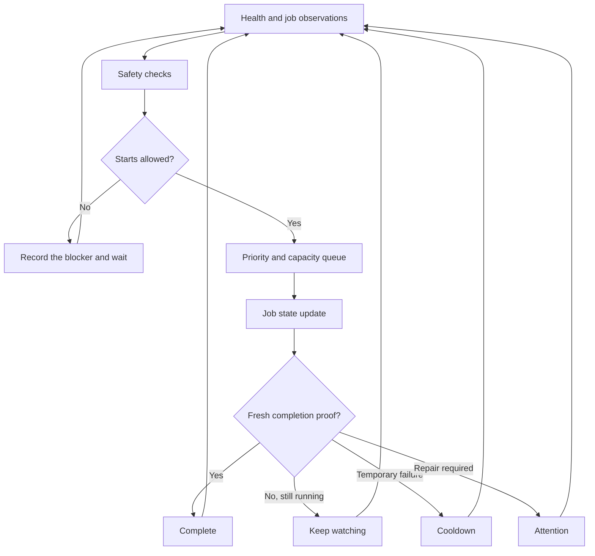

# Architecture

This public repo models the main decisions made by an automation manager. It
uses fake jobs and does not include production launchers.

## Design rules

- Health checks report facts. They do not start or stop work by themselves.
- The queue checks computer capacity before each launch.
- Temporary and repair-required failures use different states.
- A process exit is not enough to prove completion.
- Recovery waits for a verified safe condition.
- Monitor-only output has no process or write access.

## Files

| File | Purpose |
| --- | --- |
| `model.py` | Job states and structured decision events |
| `engine.py` | Priority, capacity, pause, cooldown, and recovery rules |
| `monitor.py` | Stable monitor-only screen using fake state |
| `cli.py` | Fixed failure and recovery walkthrough |
| `capture_monitor.ps1` | Window-only screenshot helper with no keyboard automation |

The full private system adds real process hosting, interactive terminal panes,
saved state, and project-specific adapters. Those details are not part of this
public repo.
