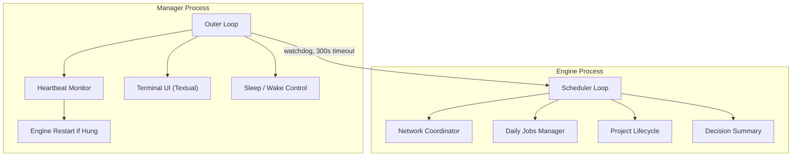
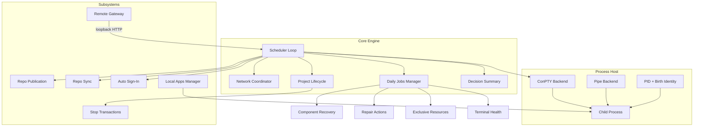
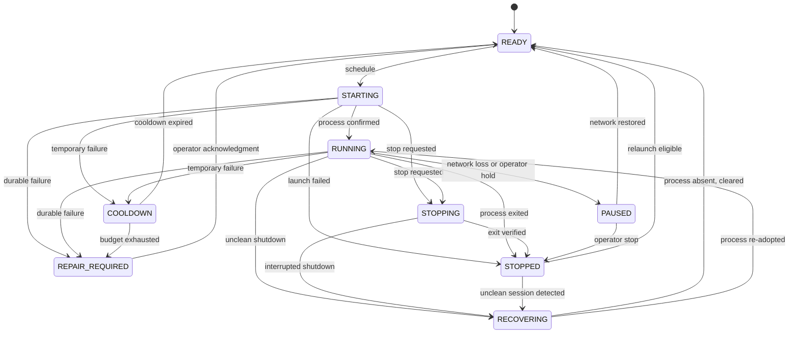
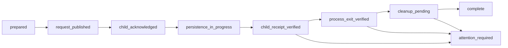

# Architecture

This document describes the architecture of the Supervisor, a self-recovering automation manager. The production implementation handles real process control; this public model demonstrates the same decision categories through a lightweight state machine.

## Two-process architecture

The Supervisor uses a two-process architecture:

The manager process runs an outer loop that monitors the engine's heartbeat. If the engine hangs (no heartbeat advance within 300 seconds), the manager restarts it after a 5-second delay. The engine process runs the inner scheduling loop and makes all decisions.

## Component overview

## State machine

Projects move through explicit states with validated transitions:

### State fields per project

| Field | Purpose |
|-------|---------|
| `observed_running` | Whether the process is currently alive |
| `pids` | Set of known PIDs for this project |
| `mode` | Current operational mode (e.g. fastest/dual/slow for auto buyer) |
| `starting_until` | Timestamp when the starting window expires |
| `starting_task` | What triggered the current start |
| `starting_mode` | Mode used for the current start |
| `cooldown_until` | When the cooldown expires |
| `cooldown_until_utc` | Human-readable cooldown expiry |
| `cooldown_reason` | Why the cooldown was applied |
| `consecutive_start_failures` | Running count of failed starts |
| `restart_hold_until` | When the restart hold expires |
| `restart_hold_reason` | Why the hold was applied |
| `restart_hold_indefinite` | Whether the hold has no expiry |
| `shutdown_requested` | Whether a stop has been requested |
| `shutdown_verified` | Whether the stop was confirmed |
| `shutdown_failure_latched` | Whether the stop permanently failed |

## Stop transactions

Stopping a project is a multi-phase transaction with cryptographic evidence:

| Phase | What happens |
|-------|-------------|
| prepared | Stop request written to disk with schema version, request ID, and timestamp |
| request_published | Child process notified of the stop request |
| child_acknowledged | Child confirms it received the stop signal |
| persistence_in_progress | Child flushes its state to disk |
| child_receipt_verified | SHA-256 digest of the child's receipt is validated against the request |
| process_exit_verified | PID + birth marker identity confirmed as exited |
| cleanup_pending | Browser tabs and orphan processes cleaned up |
| complete | Transaction finalized, project marked stopped |
| attention_required | Transaction failed, requires operator intervention |
| orphaned | Process lost, transaction abandoned |

SHA-256 digests bind the stop request to the child's receipt. Cross-process mutex locks via Windows kernel prevent concurrent stop transactions on the same project.

## Process ownership

The Supervisor verifies process identity through PID plus Windows process creation timestamp (birth marker). A live process with a different birth time proves the original exited and the operating system reused its PID.

Before adopting a process, the Supervisor also verifies argv and cwd match the expected launch parameters. The `ownership_active()` method returns `False` only when wrapper exit is positively observed; transient inspection failures must not free the launch slot.

## Process hosting

The Supervisor launches child processes through a Process Host with two backends:

| Backend | Use case | How it works |
|---------|----------|-------------|
| ConPTY | Interactive terminals, Cloudflare verification, sign-in flows | Windows pseudo-terminal via `winpty` with configurable columns/rows |
| Pipe | Headless API workers, background scanners | `CREATE_NO_WINDOW`, `stdin=DEVNULL`, `stderr=STDOUT` |

The host captures output (last 65,536 characters persisted on exit via atomic write), tracks PID + birth marker identity, and verifies process liveness before adopting crash-surviving children.

## Network coordination

The Supervisor maintains a centralized network state that affects all projects:

| State | Behavior |
|-------|----------|
| ONLINE | Normal operation. All projects eligible. |
| SUSPECT | Connectivity degraded. New starts deferred. |
| OFFLINE_BACKOFF_1 | First backoff period. Running projects paused. |
| OFFLINE_BACKOFF_2 | Extended backoff. |
| OFFLINE_BACKOFF_3 | Maximum backoff before graceful stop. |
| OFFLINE_GRACEFUL_STOP | All projects gracefully stopped. |
| WAITING_FOR_NETWORK | Waiting for connectivity to return. |
| RECOVERY_AFTER_NETWORK_RETURN | Network restored. Reconciling project state. |

The Coordinator uses escalating backoff rather than immediate recovery, preventing rapid start-stop cycling during intermittent connectivity issues.

## Daily jobs

Daily jobs are a separate scheduler from live jobs. They handle verification tasks, marketplace scans, and maintenance workflows on a longer cadence.

### Component recovery

Jobs with multiple independent components can split when one component fails. The failed component is queued as a separate manual-only retry job while the healthy component completes independently. This prevents a late failure from repeating already-completed work.

### Repair actions

When a job fails due to authentication issues, the Supervisor can execute operator-triggered repair scripts. Repair sessions have their own state machine: `not_configured -> not_started -> running -> completed / failed / unknown`. On success, the failure latch resets and a fresh verification is queued.

### Exclusive resources

Jobs declare exclusive resources (CDP ports, Chrome profiles, browser instances) to prevent concurrent access to shared infrastructure. If job A holds `cdp:9511`, no other job can claim that resource until A releases it.

### Terminal health inspection

The Supervisor monitors child terminal output for issue patterns, expected wait patterns, and idle stall detection (no output for 900+ seconds). This catches hung processes that are technically alive but stopped doing useful work.

## Adaptive polling

| Mode | Interval | When used |
|------|----------|-----------|
| Active | 10 seconds | Live jobs running, work in progress |
| Quiet | 30 seconds | No active jobs, but projects due soon |
| Deep idle | 60 seconds | Nothing due for 20+ minutes |

Transitions are triggered by activity, not schedules.

## Authentication lifecycle

The Supervisor detects authentication state through read-only verification, not login attempts. Only a confirmed logged-out state triggers automatic re-authentication. The child process owns a 3-attempts-per-6-hours budget with escalating cooldowns.

## Remote control

The production Supervisor exposes a loopback HTTP gateway (Remote Protocol v1) for remote commands. The gateway uses `ThreadingHTTPServer` with manifest-verified static assets (SHA-256 hash validation).

Supported commands include: pause, resume, start/stop/restart projects, set modes, sleep, run/rerun/stop daily jobs, enable/disable projects, launch local apps, repo sync, and restart/shutdown the Supervisor. Each command has a risk tier (read, routine, disruptive, admin, dangerous).

## Repository management

### Publication

Every supervised project has a publication policy: `child_then_supervisor_fallback`, `supervisor_only`, or `publication_exempt`. Publication verifies the remote URL via SHA-256 digest before pushing. Blocked patterns (`.env`, `*.pem`, `*.key`, `id_rsa`) are rejected automatically.

### Sync

The Supervisor fetches source repositories on intervals to keep them current, with allowed-dirty-path lists that permit local runtime files.

### Run archives

Every supervised run gets its log tail archived and pushed to Git, creating an auditable history.

## Local apps

The Local App Manager handles non-automation applications (RunWay, Auto Caption, Stacklight) through manual-launch adapters with readiness timeouts, API health checks, and browser-open integration.

## Observability

Every decision produces structured information: timestamp, severity, component, project, operation, event, decision, reason, state transition, and attempt number. The production system writes a machine-readable `decision_summary.json` each cycle with all safety inputs.

## Failure isolation

Each project maintains independent state, cooldown timers, attempt counters, shutdown latches, and repair-latch conditions. A failure in one project does not prevent other eligible projects from being scheduled.

## Recovery philosophy

After an unexpected shutdown, the Supervisor:

1. Loads persisted state
2. Determines whether the previous session ended cleanly
3. Inspects persisted process ownership records
4. Reconciles against current OS processes by exact PID + birth marker
5. Detects stale or ambiguous ownership
6. Recovers safe projects
7. Holds unsafe or ambiguous projects
8. Only then enters normal scheduling

This prevents blindly relaunching a process that may still be running, or losing in-flight work from an interrupted shutdown.

## Design principles

1. **Safety over throughput.** Preventing duplicate or incompatible actions takes priority over starting work quickly.
2. **Fail-closed ambiguity.** When the system cannot determine state, it holds the safe state. It never guesses.
3. **Evidence-based completion.** Process exit alone is never trusted. Every completion requires fresh, identity-bound proof.
4. **Single-owner process model.** One supervisor owns all child processes. No duplicate-launch or split-brain.
5. **PID-reuse-safe identity.** Every process match combines PID + creation timestamp.
6. **Archetype-separated lifecycles.** Live, daily, and local projects have separate lifecycle contracts.
7. **Immutable proof artifacts.** Stop receipts and completion markers are versioned. Mutable state updated only after proof publication.
8. **Bounded concurrency.** Attempt budgets are finite. Network backoffs escalate through defined levels.
9. **Recovery is explicit.** After unclean shutdown, the system inspects, reconciles, and only then resumes.
10. **Observability is structural.** Every decision produces a structured audit trail.
